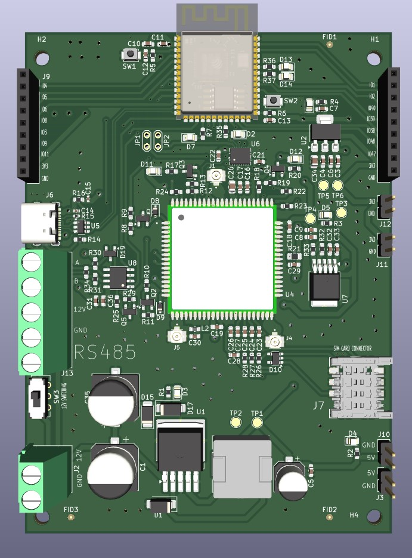
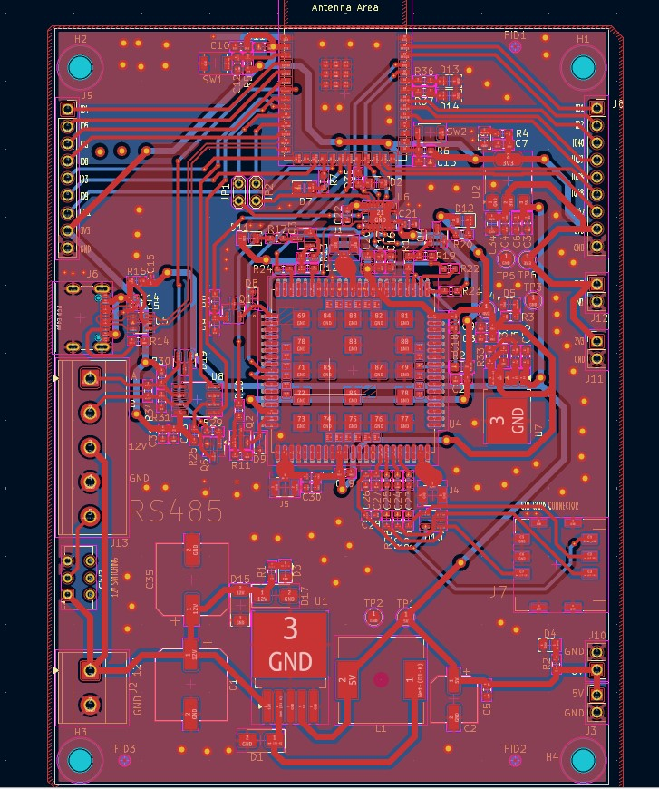
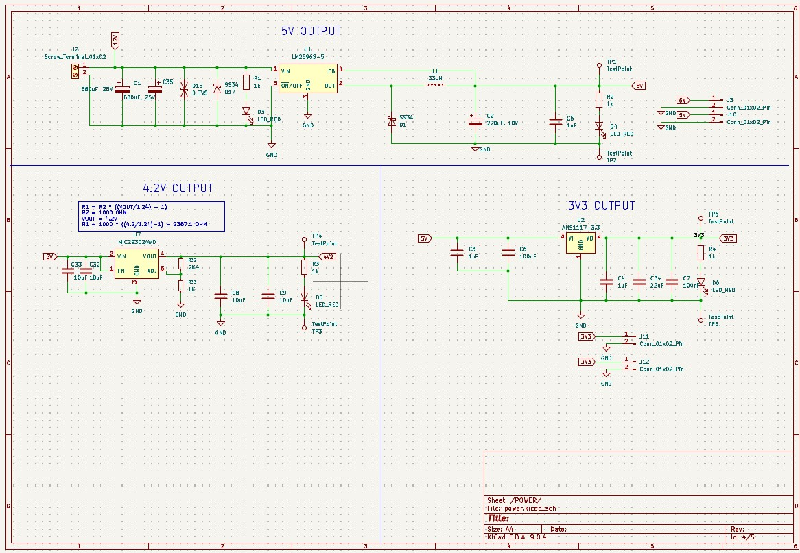
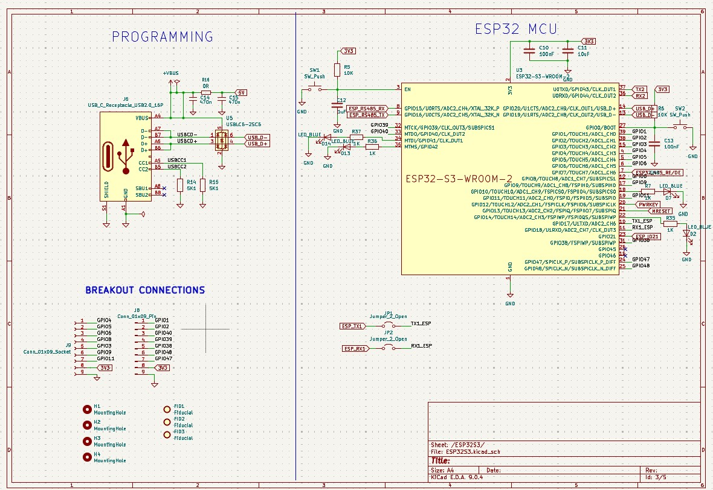
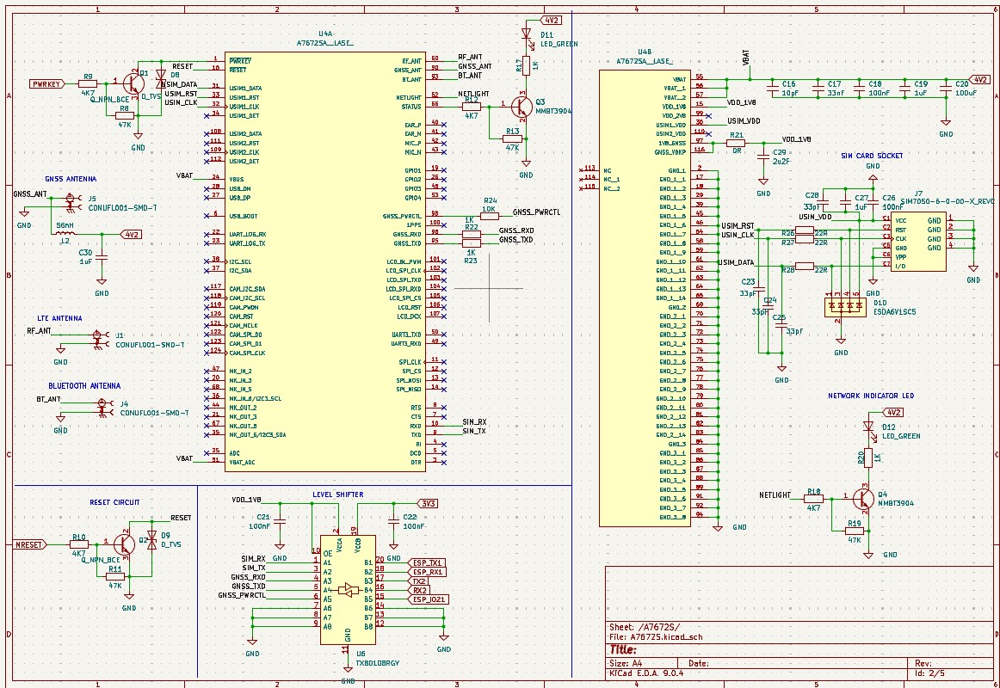
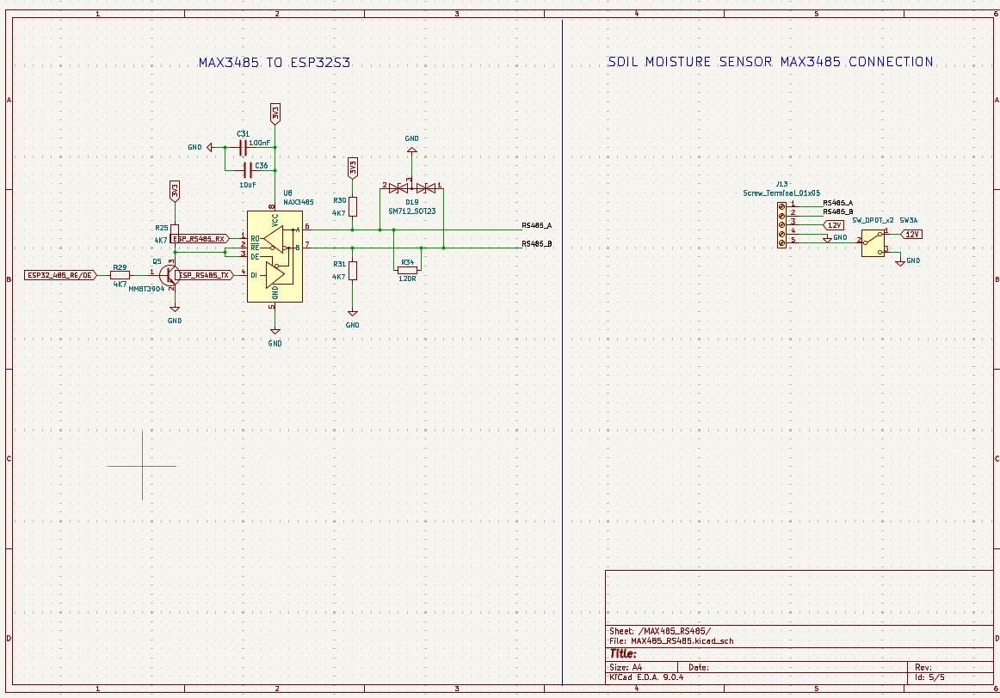

# ESP32-S3 + A7672S + RS485 Soil Moisture Node

A KiCad-designed IoT board that reads an RS485 soil sensor and sends the data over 4G LTE. It combines an **ESP32-S3** microcontroller, an **A7672SA** LTE Cat-1 modem with GNSS, and an **RS485** transceiver, all powered from a single DC input. It is built for remote soil monitoring in places with no Wi-Fi.

> **Status:** prototype, not yet fabricated or tested. <!-- TODO: update once boards arrive -->



## Features

- **ESP32-S3-WROOM-2** with Wi-Fi and Bluetooth LE, plus USB-C for programming and debugging
- **A7672SA** 4G LTE Cat-1 modem with GNSS, SIM socket, and two U.FL antenna connectors for LTE and GNSS, plus one more U.FL connector (BT_ANT) on the ESP32 side
- **RS485 interface** (MAX3485) on a screw terminal, with a 120 Ω termination switch and SM712 TVS surge protection
- **Three power rails** from one DC input: an LM2596S-5 buck converter (5 V), an AMS1117-3.3 LDO (3.3 V) for the ESP32 side, and a MIC29302 LDO (adjustable) for the modem supply (4V2)
- **Level shifting** between the ESP32 (3.3 V) and the modem (1.8 V) with a TXB0108
- **Protection:** ESD diodes on USB, SIM and RS485, plus TVS diodes on the supply
- **Usability:** reset and boot buttons, status LEDs, test points on the power rails, and 2×9 GPIO breakout headers
- **Assembly-friendly:** 2-layer board, all SMT parts on the top side, JLCPCB-compatible

## Block diagram

```
DC IN ──► LM2596S-5 ──► 5V ──┬─► AMS1117-3.3 ──► 3V3 ──► ESP32-S3 ◄── USB-C
                             └─► MIC29302 ─────► 4V2 ──► A7672SA ── SIM / LTE / GNSS
                                                              ▲
                              ESP32-S3 ◄─ TXB0108 (3V3↔1V8) ──┘
                                  │
                                  └─ UART ─► MAX3485 ─► RS485 terminal ─► soil sensor
```

## Layout



## Schematics

The design is split into four sheets.

**Power** (5 V buck, 3.3 V LDO, modem supply, protection)



**ESP32-S3** (module, USB-C, buttons, LEDs, GPIO headers)



**A7672S** (LTE modem, SIM, level shifter, antennas)



**RS485** (MAX3485, termination, surge protection)



## Target sensor

Designed for the **SenseCAP S-Temp&VWC&EC-02** soil sensor (temperature, volumetric water content and electrical conductivity) over RS485.

<!-- TODO: add sensor supply voltage, baud rate, and Modbus address/register map you use -->

## Repository layout

| Folder | Contents |
|---|---|
| `ESP32S3_A7672S_RS485_SoilMoisture/` | KiCad 9 project: schematics (`power`, `ESP32S3`, `A7672S`, `MAX485_RS485`) and PCB layout |
| `Mfr/` | Manufacturing files: Gerbers, drill files, BOM and CPL for JLCPCB |
| `images/` | Renders and screenshots |

## Board specifications

| | |
|---|---|
| Size | 81.5 × 111.3 mm |
| Layers | 2 |
| Assembly | Single-sided SMT (top), through-hole parts hand-soldered |
| Mounting | 4 × M3 holes |
| Design tool | KiCad 9 |

## Ordering the board

1. Upload the Gerber zip from `Mfr/` to JLCPCB.
2. Choose SMT assembly, top side, and upload the BOM and CPL.
3. Through-hole parts (screw terminals, pin headers, DIP switch) are not placed by SMT assembly. Solder them by hand or select JLCPCB's through-hole option.

## Getting started

<!-- TODO: fill in once firmware exists -->
1. Connect the DC supply to the power screw terminal. <!-- TODO: state the input voltage range -->
2. Insert a SIM card and attach the LTE and GNSS antennas **before** powering on.
3. Wire the soil sensor to the RS485 terminal (A, B, GND and sensor supply).
4. Connect USB-C to flash the ESP32-S3.

## Pin assignments

<!-- TODO: add a table of ESP32-S3 GPIOs for modem UART, modem power key/reset, RS485 TX/RX/DE, LEDs -->

## Firmware

<!-- TODO: link firmware repo or describe planned stack (ESP-IDF / Arduino, AT-command library, Modbus library, MQTT/HTTP endpoint) -->


## License

<!-- TODO: choose one, e.g. CERN-OHL-P-2.0 for hardware, MIT for firmware -->

## Author

Victor Waburi ([@Vtechcode](https://github.com/Vtechcode))
